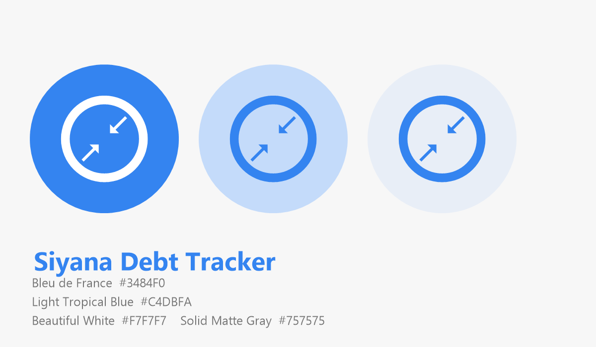

# Design System — Siyana Code

> **Last updated:** 2026-10-15
> The visual and interaction language of Siyana Debt Tracker.



---

## 1. Brand

| | |
|---|---|
| **Product** | Siyana Debt Tracker |
| **Brand** | Siyana Code |
| **Author** | Rasindu Appuhami |
| **Licence** | MIT |

The brand mark is a coin holding two opposing arrows: money leaving toward the
upper right (lent), money entering from it (borrowed). It states the product's
entire purpose in one glyph, and it mirrors the app's own UI convention of
carrying direction in shape rather than colour.

### Mark assets

| File | Use |
|---|---|
| `assets/icon.png` | iOS launcher icon, web, store listings |
| `assets/adaptive-icon.png` | Android launcher foreground (transparent) |
| `assets/monochrome-icon.png` | Android themed icons |
| `assets/splash-icon.png` | Launch screen |
| `assets/favicon.png` | Web |
| `assets/brand-sheet.png` | Documentation and marketing |
| `assets/source/*.svg` | **Editable design source — change these** |

Regenerate every raster export with:

```bash
npm run icons
```

---

## 2. Colour palette

The standard Siyana Code web UI palette. Four colours, each with a fixed job.

| Colour | Hex | Role |
|---|---|---|
| **Bleu de France** | `#3484F0` | Primary accent · links · major action buttons |
| **Light Tropical Blue** | `#C4DBFA` | Soft backgrounds · hover highlights · secondary containers |
| **Beautiful White** | `#F7F7F7` | Core layout background · card structural backing |
| **Solid Matte Gray** | `#757575` | Secondary text · borders · dividers · disabled states |

Source of truth: [`src/theme/colors.ts`](../src/theme/colors.ts).

### 2.1 Neutral ramp

Derived from Solid Matte Gray and Beautiful White, so components never need a
raw hex value.

| Token | Hex | Use |
|---|---|---|
| `neutral[0]` | `#FFFFFF` | Card surface (light) |
| `neutral[50]` | `#FAFAFA` | Subtle background |
| `neutral[100]` | `#F7F7F7` | Beautiful White — app background |
| `neutral[200]` | `#EBEBEB` | Disabled fills |
| `neutral[300]` | `#DDDDDD` | Borders |
| `neutral[400]` | `#B9B9B9` | Placeholder text |
| `neutral[500]` | `#757575` | Solid Matte Gray — secondary text |
| `neutral[600]`–`[900]` | `#616161`…`#1A1A1A` | Text hierarchy |

### 2.2 Alpha tokens

| Token | Value | Use |
|---|---|---|
| `alpha.bleu08` | `rgba(52,132,240,.08)` | Card hover / icon chip |
| `alpha.bleu12` | `rgba(52,132,240,.12)` | Selected row |
| `alpha.bleu16` | `rgba(52,132,240,.16)` | Dark-mode hover |
| `alpha.bleu24` | `rgba(52,132,240,.24)` | Inverted stat tile icon chip |
| `alpha.white16` / `white24` | `rgba(255,255,255,·)` | Text on primary |
| `alpha.overlay` | `rgba(26,26,26,.55)` | Modal backdrop |

### 2.3 Semantic status colours

Only two states need a hue the brand palette cannot express. Both come from the
standard Material ramp and are documented as deliberate extensions.

| Token | Hex | Surface | Use |
|---|---|---|---|
| `status.overdue` | `#B3261E` | `#FCEEEC` | Past due, still outstanding |
| `status.partial` | `#B26A00` | `#FDF3E3` | Part paid, or due soon |
| `status.settled` | `#757575` | `#F2F2F2` | Reuses Solid Matte Gray — no new colour |

> **Adding a colour is a design change.** Update this table *and*
> `src/theme/colors.ts` together. A colour that appears in a component but not
> here is a defect.

### 2.4 Dark palette

A parallel set, not an inversion. Beautiful White becomes `#101418`; Bleu de
France stays the accent; Solid Matte Gray lifts to `#A9B2BD` so secondary text
keeps contrast.

| Token | Dark value |
|---|---|
| `background` | `#101418` |
| `surface` | `#171C22` |
| `surfaceMuted` | `#1F252D` |
| `surfaceSunken` | `#0B0E12` |
| `primaryContainer` | `#1B3A63` |
| `border` | `#2C343E` |
| `text` | `#F2F4F7` |
| `textSecondary` | `#A9B2BD` |
| `textDisabled` | `#5C6570` |

---

## 3. Typography

The standard Google Material type scale.

| Token | Size | Weight | Use |
|---|---|---|---|
| `display` | 34 | 700 | Hero amount on a debt |
| `title` | 28 | 700 | Net balance, person name |
| `heading` | 22 | 600 | Stat tile value |
| `subheading` | 18 | 600 | Screen titles, row titles |
| `body` | 16 | 400 | Row subtitles, settings labels |
| `callout` | 15 | 500 | Amounts in dense lists |
| `caption` | 13 | 400 | Supporting text |
| `micro` | 11 | 400–700 | Badge and stat captions |

Sizes are **fixed**, not scaled by a user font-size setting, so dense screens
stay predictable. `letterSpacing` does the work of creating hierarchy without
adding copy: `tight` (-0.4) for large numerals, `caps` (+1.1) for uppercase
section labels.

---

## 4. Spacing, radius, elevation

### Spacing — 4pt scale

`none 0` · `xxs 2` · `xs 4` · `sm 8` · `md 12` · `lg 16` · `xl 20` · `xxl 24` ·
`xxxl 32` · `huge 40`

Screen padding is `lg` (16). Card padding is `lg`. Row vertical padding is `md`
with a 62 pt minimum height.

### Radius

`none 0` · `sm 6` · `md 10` · `lg 14` · `xl 20` · `pill 999`

Cards and sheets use `lg`/`xl`; inputs and buttons use `md`; chips and badges are
fully rounded.

### Elevation

| Level | Use |
|---|---|
| `card` | 2 pt, 10 % shadow — resting list items |
| `sheet` | −4 pt offset, 16 % — bottom sheets |
| FAB | 6, 22 % shadow, 12 pt radius |

---

## 5. Iconography

**Ionicons** (bundled with Expo). No other set. No emoji anywhere in the product.

### 5.1 The core rule — icons before text

Every primary action is recognisable by glyph alone. Text labels are secondary
reinforcement, never the only signal.

| Concept | Glyph |
|---|---|
| Lent (they owe you) | `arrow-up-right` |
| Borrowed (you owe them) | `arrow-down-left` |
| Add debt | `add` / `add-circle` |
| Add person | `person-add-outline` |
| Record payment | `checkmark` / `receipt-outline` |
| Settled | `checkmark-circle` / `checkmark-done` |
| Overdue | `alert-circle` / `alert` |
| Due soon | `time` |
| Part paid | `pie-chart` |
| Search | `search` / `search-outline` |
| Filter | `options-outline` |
| Export | `download-outline` / `code-slash-outline` / `grid-outline` |
| Delete | `trash-outline` |
| Archive | `archive-outline` |
| Settings | `settings` / `settings-outline` |

### 5.2 Direction is never colour-coded

Lent versus borrowed is carried by **arrow shape and direction**, never by red
and green. Around 8 % of men have some red/green colour vision deficiency, and
this app is read outdoors on cheap screens — both make colour-only encoding a
genuine failure. The arrow says it unambiguously at any contrast.

### 5.3 Status is never colour alone

Every coloured badge pairs an **icon** with a **text label**:

```tsx
<Badge label="Overdue" icon="alert-circle" tone="overdue" />
```

Remove the colour entirely and the badge still reads. That is the test.

### 5.4 Sizes

| Context | Size |
|---|---|
| Tab bar | 22 |
| Row leading icon | 30–32 |
| List trailing | 14–17 |
| Inline field icon | 18 |
| Badge / stat chip | 11–15 |
| Empty state | 40 (28 compact) |
| Hero direction card | 26 |

---

## 6. Component kit

All in [`src/components/ui/`](../src/components/ui/).

| Component | Purpose |
|---|---|
| `Screen` | Safe-area aware shell; `scroll`, `footer` and refresh built in |
| `Card` | Surface with an optional press target |
| `SectionHeader` | Uppercase label with an optional trailing action |
| `Button` | `primary` · `secondary` · `ghost` · `danger`; icon optional |
| `IconButton` | Circular, 40 pt, optional badge |
| `Field` | Labelled input with leading icon, focus state, error |
| `Badge` | Status pill — always icon + label |
| `StatTile` | Icon + value + uppercase caption |
| `ProgressBar` | Settlement progress with an accessible value |
| `Avatar` | Deterministic initials on a brand-family tint |
| `ListRow` / `PersonRow` | The standard row |
| `SearchBar` | With live-clear |
| `SegmentedControl` | Icon-and-label filter |
| `Sheet` / `SheetOption` | Bottom sheet and its options |
| `EmptyState` | Icon-led; at most one action |
| `Skeleton` | Pulsing placeholder blocks |
| `Divider` | Hairline rule |

---

## 7. Interaction rules

| Rule | Why |
|---|---|
| Minimum touch target 44×44, plus hit slop | Reachability one-handed, on a large phone |
| Pull to refresh on every list | Restores data without navigating |
| Destructive actions always confirmed, naming the loss | Undo is not guaranteed for delete/erase |
| Save stays disabled until the form is valid | The reason is shown inline, never guessed |
| No hidden gestures | No swipe-to-delete without a visible equivalent |
| Skeletons, never spinners | There is no network to wait for; spinners imply latency that does not exist |
| Icon-only where the glyph is unambiguous | Reduces reading and translation burden |

---

## 8. Accessibility

| Requirement | Implementation |
|---|---|
| Every control labelled | `accessibilityLabel` on all interactive elements |
| Correct roles | `button`, `radio`, `tab`, `tablist`, `progressbar` |
| Progress values exposed | `accessibilityValue={{min, max, now}}` |
| Selection exposed | `accessibilityState={{ selected, disabled, busy }}` |
| Contrast | Body ≥ 4.5:1, icons and borders ≥ 3:1 |
| No colour-only meaning | Icon + label on every status |
| Touch targets | 44 pt minimum, generous hit slop |
| Motion | Only the skeleton pulse; nothing decorative |

---

## 9. Voice

| Do | Don't |
|---|---|
| "Record your first debt" | "Get started!" |
| "5 days overdue" | "You have an overdue item!" |
| "Nothing matches" | "No results found" |
| "This also deletes every payment" | "Are you sure?" |

Plain, specific, and honest about consequences. The app is used by people
handling money they care about — the tone should never be jokey or vague.

---

## 10. Adding to the system

1. Check whether the need is real. Most additions are an existing component
   with a different icon.
2. Use an Ionicons glyph. Do not introduce a second icon set, and never an emoji.
3. If you need a colour, add it here **and** to `src/theme/colors.ts`.
4. If you need a type size, add it to `src/theme/typography.ts` and use it
   consistently.
5. Every interactive component needs a label and a role.
6. Every interactive component needs a 44 pt minimum target.